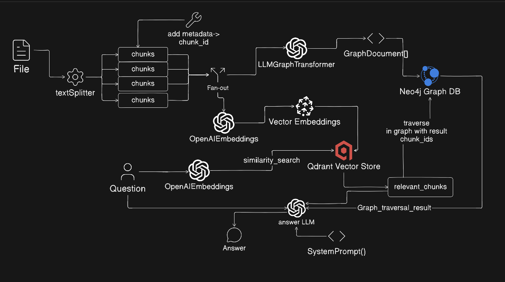
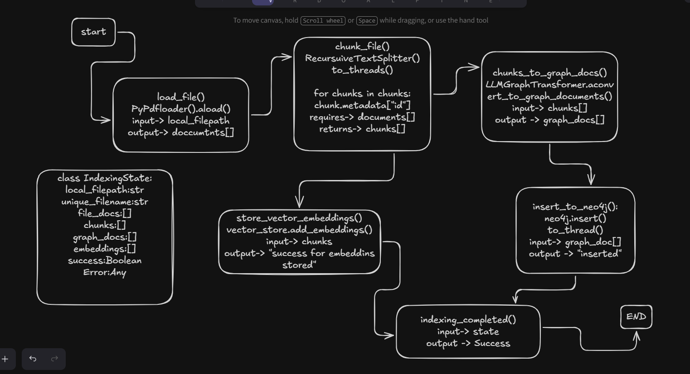
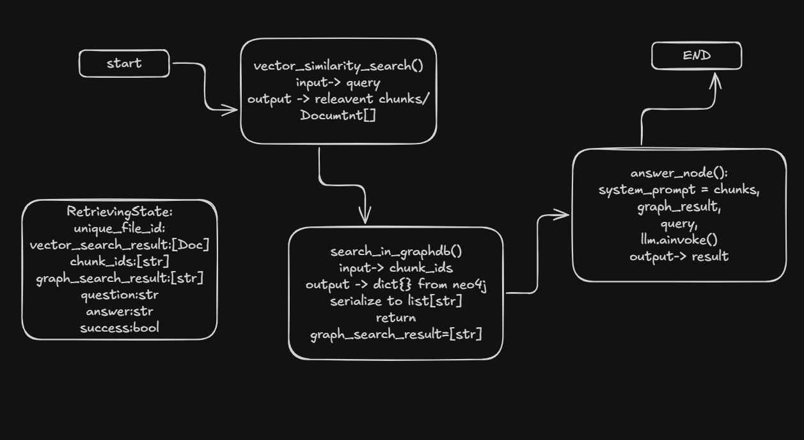

# Hybrid RAG — Vector Search + Knowledge Graph

A Hybrid Retrieval-Augmented Generation (RAG) system that combines **semantic vector search with Knowledge Graph-based retrieval** to improve contextual understanding and retrieve connected information across documents.

## System Architecture

The system maintains two complementary representations of the same source information: a vector index for semantic retrieval and a knowledge graph for relationship-based retrieval.

### Hybrid RAG Architecture Diagram

<!-- Replace the placeholder path with your architecture diagram -->



*Figure 1: High-level architecture illustrating document ingestion, vector indexing, knowledge graph construction, and hybrid retrieval.*

## Indexing Pipeline

The indexing pipeline transforms source documents into searchable vector representations and structured graph data.

### Diagram


*Figure 1: LnagGraph architecture illustrating document ingestion, parallal execution of vector indexing and knowledge graph construction.*

### 1. Document Loading and Chunking

Documents are loaded and split into manageable chunks using LangChain document-processing components.

Each chunk should retain metadata such as its source, document identifier, and chunk identifier. These identifiers help trace retrieved content back to its original document.

### 2. Vector Indexing

Each text chunk is converted into an embedding using the configured embedding model.

The embeddings, associated text, and metadata are stored in Qdrant, enabling semantic similarity search during retrieval.

### 3. Knowledge Graph Construction

The document content is processed using `LLMGraphTransformer` to extract entities and relationships.

The extracted graph structures are then persisted in Neo4j, where connected entities can be explored using graph queries and traversal.

### 4. Parallel Indexing

Vector indexing and graph indexing can execute as parallel branches because they are largely independent after document preparation.

However, the indexing workflow must wait for both branches to complete before reporting overall success.

A production-oriented implementation should also account for failures, retries, duplicate writes, and consistency between the two storage systems.

## Hybrid Retrieval Pipeline

The retrieval process combines semantic search with graph-based context expansion.

### Retrieval Steps

### Diagram


1. **Query Processing:** Receive the user's natural-language question.
2. **Vector Search:** Generate a query embedding and retrieve semantically similar chunks from Qdrant.
3. **Graph Entry-Point Resolution:** Use the retrieved chunk identifiers or source metadata to locate corresponding graph records.
4. **Graph Traversal:** Explore relevant entities and relationships connected to the retrieved content in Neo4j.
5. **Context Assembly:** Combine relevant text chunks with useful graph-derived information.
6. **Answer Generation:** Pass the assembled context and original query to the LLM to generate a grounded response.

## Key Features

- Document loading, preprocessing, and chunking.
- Semantic embedding generation and indexing in Qdrant.
- Entity and relationship extraction using LangChain's `LLMGraphTransformer`.
- Knowledge graph construction and storage in Neo4j.
- Shared identifiers and metadata for connecting text chunks with graph entities.
- Graph traversal to retrieve related information.
- Hybrid context assembly for LLM-based response generation.
- LangGraph orchestration for coordinating indexing workflows.

## Tech Stack

| Technology | Purpose |
|---|---|
| Python | Core backend implementation |
| LangChain | Document processing, embeddings, and LLM integrations |
| LangGraph | Workflow orchestration |
| Qdrant | Vector storage and semantic similarity search |
| Neo4j | Knowledge graph storage and relationship traversal |
| LLMGraphTransformer | Entity and relationship extraction |
| Embedding Model | Converts text chunks into vector representations |
| LLM | Generates answers from retrieved context |

## Chunk-to-Graph Mapping

One of the key challenges in Hybrid RAG is linking vector search results to the corresponding graph structures.

Qdrant and Neo4j store different representations of information. A shared identifier strategy provides the connection between them.

For example, a vector record may contain the following metadata:

```json
{
  "unique_file_id": "doc_123",
  "chunk_id": "chunk_007",
  "source": "https://example.com/document"
}
```

The same document or chunk identifier can be stored in Neo4j to establish a relationship between the source text and the extracted graph entities.

An illustrative graph model could look like this:

```text
(:Document)
     |
     | HAS_CHUNK
     v
(:Chunk)
     |
     | MENTIONS
     v
(:Entity)
     |
     | RELATED_TO
     v
(:Entity)
```

This structure enables the retrieval process to move from a relevant vector chunk to its graph representation and then explore related entities.

The exact metadata fields and graph schema should match the implementation in the repository.

## Setup and Installation

### Prerequisites

- Python and a compatible dependency environment.
- A running Qdrant instance.
- A running Neo4j instance.
- Credentials for the configured LLM and embedding providers.

### 1. Clone the Repository

```bash
git clone https://github.com/Rounak-24/Hybrid-PDF-RAG.git
```

### 2. Create a Virtual Environment

**Windows PowerShell:**

```powershell
python -m venv .venv
.\.venv\Scripts\activate
```

**Linux/macOS:**

```bash
python -m venv .venv
source .venv/bin/activate
```

### 3. Install Dependencies

```bash
pip install -r requirements.txt
```

### 4. Configure Environment Variables

Create the `.env` file and add the credentials and connection settings required by the application.

### 5. Start the Application

Use the entry point configured in your repository. For example, if the application exposes a FastAPI instance at `app.main:app`:

```bash
python -m app.main
```